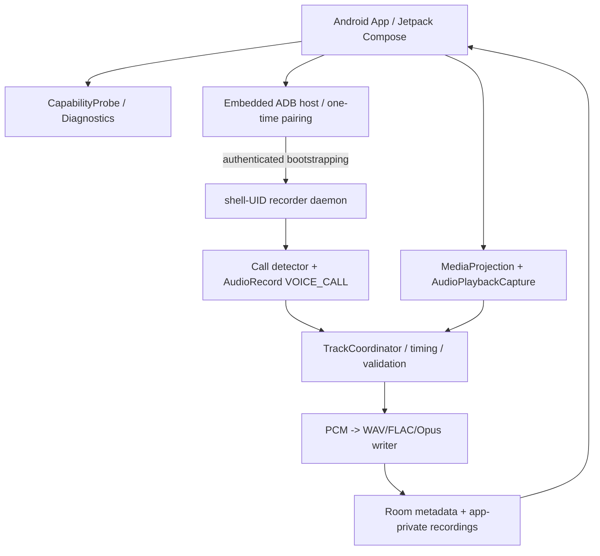

# Record — Android 非 Root 錄音技術說明書（TECHNICAL）

> 版本：v1.0（架構設計／技術研究基線）｜日期：2026-11-06｜狀態：方案待實機 PoC 驗證
>
> 產品規格：[PRD.md](./PRD.md)。本文說明技術路線、Android 安全模型、模組、資料流、碼率與檔案、權限、例外、測試及可參考原始碼。**未聲稱目前已完成 Record App。**

## 0. 最重要的工程結論

1. Android 普通 APK **不能因取得 `RECORD_AUDIO` 就錄到電信通話雙方**。`VOICE_CALL`、`VOICE_UPLINK`、`VOICE_DOWNLINK` 涉及系統保護的 `CAPTURE_AUDIO_OUTPUT` 等權限；普通 App 不可直接取得。
2. 已找到非 Root 的公開做法：使用者自主完成 **無線 ADB 配對**，由具有 `shell` UID 的程序擷取通話音訊，普通 App 負責 UI、設定和檔案。`JemRec` 是優先架構參考；`CallVault`、`ShizuCallRecorder` 是交叉驗證候選。這不是標準公開 SDK 所保障的通用能力。
3. 一般媒體／遊戲聲音採官方 **AudioPlaybackCapture + MediaProjection**；只限允許捕捉且 `USAGE_MEDIA`／`USAGE_GAME`／`USAGE_UNKNOWN` 的 App，不包括一般受保護的通話音訊。
4. 兩種擷取機制可單獨研究，**不等於可在同一通話中同時運作**。Android 可能將另一音源靜音、改路由或拒絕啟動。這是本案最大未解風險。
5. 若以 PCM 擷取再保存 WAV/FLAC，可避免**新增有損重編碼**；但原本經電信 codec 壓縮的音質無法還原，不可宣稱真實電信無損原音。
6. `JemRec` 和 `scrcpy` 為 Apache-2.0；`ShizuCallRecorder`、`CallVault`、`Ever-Call-Recorder` 為 GPL-3.0 路線，直接移植須依法履行授權義務；`Koel` 未找到 LICENSE，**勿直接複製**。

## 1. 來源與官方文件（2026-11-06 核對）

### 1.1 直接相關 Repo

| Repo | 已公開的技術／實作 | 我方用途 | 授權／注意 |
|---|---|---|---|
| [JemRec](https://github.com/jemcik/JemRec) | Android 12+；自我無線 ADB 配對；`app_process` 啟動 shell daemon；通話雙方；Opus 儲存；重啟狀態／診斷 | **首選架構參考**：ADB bootstrap、daemon生命週期、IPC、呼叫狀態、錯誤警報 | Apache-2.0；見 [架構細節](https://github.com/jemcik/JemRec/blob/main/docs/ARCHITECTURE.md)、[開發說明](https://github.com/jemcik/JemRec/blob/main/docs/DEVELOPMENT.md) |
| [CallVault](https://github.com/madkongo/CallVault) | Android 11+／arm64；內嵌 ADB 或 Shizuku；通話及部分 App 通話、Opus/AAC、備份／管理 | 組合 UI + daemon、雙模式設定、崩潰復原、通知 | GPL-3.0 + 附加條款；作者註明是 ShizuCallRecorder 衍生 |
| [ShizuCallRecorder](https://github.com/kitsumed/ShizuCallRecorder) | Shizuku／ADB shell；雙方聲音；可能分離上、下行；VoIP 是 best-effort | 與 JemRec 交叉比對音源、裝置相容性 | GPL-3.0，附加條款；不是可無條件拷貝進閉源 App |
| [AVault](https://github.com/arpanjot-coding/AVault) | Shizuku、AES-256-GCM、Android Keystore、鎖定與清理功能 | 隱私與加密設計 | LICENSE 開頭 MIT、後附較長研究免責聲明；需確認完整權利範圍 |
| [Ever Call Recorder](https://github.com/hari161008/Ever-Call-Recorder) | Shizuku、雙向錄音宣稱、WhatsApp／Telegram、自動錄音 | 輔助對照功能與 UI | GPL-3.0；README 列 ShizuCallRecorder 為參考 |
| [Koel](https://github.com/strider-ape/Koel) | Poco M4 Pro 4G / Android 13 實測；Shizuku shell `AudioRecord(VOICE_CALL)` → AAC；說明 ShellContext | 最小非 Root 單機 PoC 參考 | 目前未找到 LICENSE；僅閱讀技術，不直接複製程式碼 |
| [scrcpy](https://github.com/Genymobile/scrcpy) | `voice-call`／`voice-call-uplink`／`voice-call-downlink`／`playback` 等音源；Opus、AAC、FLAC、raw PCM | 音源抽象、音訊寫入與解碼、相容性技術參考 | Apache-2.0；是桌面鏡像產品，不是手機上可直接運作的完整錄音 App |

**不採用作為主線**：[BCR](https://github.com/chenxiaolong/BCR) 的 README 明言依賴 Root／系統 App／自訂韌體；只可參考編碼、儲存及音軌測試思想，本案不得以 Root 解決。

### 1.2 Android 官方規格

- [MediaRecorder.AudioSource](https://developer.android.com/reference/android/media/MediaRecorder.AudioSource)：`VOICE_CALL`、`VOICE_UPLINK`、`VOICE_DOWNLINK` 與 `CAPTURE_AUDIO_OUTPUT`。
- [Sharing audio input](https://developer.android.com/media/platform/sharing-audio-input)：通話中的音源優先級，普通 App 可能拿到**靜音**。
- [AudioPlaybackCaptureConfiguration](https://developer.android.com/reference/android/media/AudioPlaybackCaptureConfiguration)：可擷取的 usage／來源政策／用戶設定檔限制。
- [Capture video and audio playback](https://developer.android.com/media/platform/av-capture)：MediaProjection 授權、`AudioRecord.Builder.setAudioPlaybackCaptureConfig`。
- [Android 14 foreground service types](https://developer.android.com/about/versions/14/changes/fgs-types-required)：`microphone`、`mediaProjection`、`phoneCall` 必須符合實際用途；`phoneCall` 不是任意通話錄音權限。
- [Google Play Developer Program Policy](https://support.google.com/googleplay/android-developer/answer/18265346?hl=en)：Accessibility API 不得用來做遠端通話錄音或規避安全與隱私控制。

## 2. 架構總覽



### 2.1 技術堆疊

| 層次 | 建議方案 | 理由 |
|---|---|---|
| Android App | Kotlin、Jetpack Compose、Material 3 | 簡潔原生設定／錄製／檔案管理 |
| DI | Hilt 或簡化手動 DI | 讓音源／編碼器可替換，測試 mock |
| 本機設定 | DataStore | 保存開關、路由及保留規則 |
| 本機資料庫 | Room | 記錄 metadata、片段、測試、失敗碼 |
| 通話權限引導 | 系統 Settings Intent、ADB wireless pairing 流程 | 不隱藏高權限需求 |
| 非 Root 通話 backend | **內嵌 ADB client + 獨立 shell daemon** | 參考 JemRec；普通 APK 不直接取音源 |
| 可選後備 backend | Shizuku service | 給已安裝 Shizuku 的開發者用；非預設 |
| 媒體音源 | MediaProjection / AudioPlaybackCapture | 官方限定條件下的播放音訊擷取 |
| PCM 讀取 | AudioRecord | 需要按音源與程序身分分別初始化 |
| 有損備選 | MediaCodec Opus／AAC（可用時） | 小容量、相容性較好 |
| 無損 | WAV（PCM）／FLAC（可用時軟／硬體 encoder） | 避免再次有損壓縮 |
| 音訊檔案管理 | app-private files + Storage Access Framework 匯出 | 預設私有、使用者決定外流 |
| 本機加密 | Android Keystore + AES-256-GCM | 可選，金鑰不明文放資料庫 |
| Build/CI | Gradle、Android SDK、JDK、GitHub Actions | 靜態檢查、測試與可追溯 APK |

### 2.2 建議專案目錄

```text
Record/
  PRD.md
  TECHNICAL.md
  settings.gradle.kts
  app/                    # Compose, ViewModels, permission wizard
  core/model/             # Track, Capability, Session, ErrorCode
  core/storage/           # Room, files, export, encryption
  core/audio/             # PCM framing, encoders, segment writer
  core/diagnostics/       # Quality checks, capability probes
  feature/calls/          # call sessions, telephony UI
  feature/playback/       # MediaProjection, AudioPlaybackCapture
  feature/library/        # list, play, export, retention
  privileged/shellserver/ # 自有 shell 端 daemon / IPC protocol
  privileged/adb/         # embedded ADB host + pairing
  privileged/shizuku/     # optional backend, feature flag
  docs/compatibility/     # devices and test results (no audio)
  tools/                  # local anonymized audio fixture tools
  .github/workflows/      # build / unit / lint / instrumentation
```

## 3. 非 Root 通話錄音：權限模型與資料路徑

### 3.1 Android 真正的權限邊界

- `android.permission.RECORD_AUDIO`：普通 App 可請求，但**不能單獨錄取電信通話下行**。
- `MediaRecorder.AudioSource.VOICE_CALL`：代表通話上下行的混合輸入；通常需要 `CAPTURE_AUDIO_OUTPUT`，這是系統保護的權限。
- `VOICE_UPLINK`／`VOICE_DOWNLINK`：分別是本地上行／對方下行音源，也同樣受保護；裝置可能不支援或只提供混音。
- `CAPTURE_VOICE_COMMUNICATION_OUTPUT`：在較新 Android／部分通訊情境也可能成為限制條件；以裝置行為為準。
- JemRec 的架構文件說明某些 Android 裝置上的 `com.android.shell` 身分具有可用錄音權限；**是實測依據，不是 Google 對所有 OEM 承諾的公有 API**。
- 不可宣稱透過 `pm grant` 就能把簽章保護權限授予普通 App；真正擷取端必須在其合法可用的身份與安全模型內執行。

### 3.2 首次啟用（建議 JemRec 類型）

1. 使用者進入 Record，先看到「需開啟開發者選項及無線偵錯」與裝置安全／錄音法律提示。
2. 使用者自行於 Android 設定啟用開發者選項、無線偵錯及必要 ADB 配對流程。
3. App 的內嵌 ADB client 經過系統 pairing handshake，在本機 loopback 與 `adbd` 建立認證工作階段；配對憑證存 App 私有儲存區，避免紀錄到 log。
4. 由 ADB shell 啟動**自己實作且經校驗簽章／雜湊**的 daemon，例如以 `app_process` 載入 dex/jar（參見 JemRec 技術文件）；daemon 使用 shell UID，App 不會因此自動得到 shell 權限。
5. App 與 daemon 建立 authenticated local IPC，進行版本與 capabilities handshake。
6. daemon 負責通話偵測、`AudioRecord` 與片段錄製；App 顯示真實狀態、提交本機檔案、品質驗證。
7. 需要重啟時才重新啟動 ADB bootstrap；配對有效不等於 daemon 會在重開機後常駐，必須實測 Wi-Fi／OEM 背景限制。

**避免做法**：未授權開啟對外 ADB TCP port、常駐無認證 socket、宣稱可靜默取得使用者未同意的系統權限、隱藏受保護的系統隱私提示。

### 3.3 通話狀態與輸入事件

- 普通 App 可用 `TelephonyCallback` / `TelephonyManager` 在合法權限與 API 能力內辨識來電／去電狀態；不同 Android 版本限制不同。
- 過濾來電／未接／等待／轉接／多 SIM 時應建立狀態機，不能依賴只有「響鈴」就算接通。
- daemon 開始錄音前應確認 AudioRecord 初始化與實際讀取回傳可用；通話結束要 flush encoder、關閉 writer、最後才將檔案狀態設為 complete。
- 不能依賴 READ_CALL_LOG 一定可用：其權限可能受到 Android 與商店政策嚴格限制。沒有電話號碼時仍須能以時間 UUID 儲存錄音。

**建議狀態機**：

```text
UNCONFIGURED -> WAITING_PAIRING -> STARTING_DAEMON -> READY
READY + call connected -> CAPTURING
CAPTURING + call ended -> FINALIZING -> VALIDATING -> SAVED
任一狀態發生錯誤 -> DEGRADED / NEED_USER_ACTION / UNSUPPORTED
重啟後 -> WAITING_RESTART -> RECOVERING -> READY（驗證成功後）
```

### 3.4 daemon 的權限與隔離

- 保持「短時間 ADB bootstrap、長時間 shell daemon」而非「整場通話透過 ADB stream」；減少 Wi-Fi 消失造成的串流中斷風險。
- daemon 只接受最小指令：`PING`、`CAPABILITIES`、`START`、`STOP`、`STATUS`、`LIST_READY_SEGMENTS`、`TRANSFER_SEGMENT`、`ACK_SEGMENT`；不提供一般 shell 執行任意命令的 IPC endpoint。
- IPC 使用 Unix-domain socket 或 loopback + 強制雙端驗證、隨機 session secret、版本與協定 nonce；daemon 每次檢查 caller identity。不可將 token 寫入公開下載目錄。
- 每次傳檔先確認 size、hash、write-complete flag，再由 App 提交到私有庫；**只有寫入成功／checksum 通過後** 才 ACK 刪除暫存。
- app 被 OEM 暫停或殺死時，daemon 應自行完成檔案；App 下次啟動再收集。
- 使用者關閉錄音／撤回權限時，應有確定停止機制；不可設計成違背用戶控制的隱藏常駐程序。

## 4. 手機內部播放音訊：官方 API

### 4.1 AudioPlaybackCapture 所需條件

1. Android 10（API 29）以上；使用者自行授權 MediaProjection 畫面擷取系統對話框。
2. App 需要 `RECORD_AUDIO`、適用的 `FOREGROUND_SERVICE`／`FOREGROUND_SERVICE_MEDIA_PROJECTION` 等權限及正確 foreground service type；Android 14+ 有 token 使用與服務起始限制，應依 targetSdk 分別處理。
3. 目標播放 App 的音源用途只能是 `USAGE_MEDIA`、`USAGE_GAME`、`USAGE_UNKNOWN`。
4. 目標 App／播放器必須允許 `ALLOW_CAPTURE_BY_ALL`，並滿足 manifest／user-profile 限制；DRM、通話、敏感用途不能以此 API 繞過。
5. MediaProjection 授權與 session life cycle 由 Android 系統控制；使用者停止共享或撤回授權必須停止擷取。

### 4.2 官方 AudioRecord 建構方向（示意，非完整可直接編譯程式）

```kotlin
// 先由 MediaProjectionManager + Activity Result 取得系統授權。
val captureConfig = AudioPlaybackCaptureConfiguration.Builder(projection)
    .addMatchingUsage(AudioAttributes.USAGE_MEDIA)
    .addMatchingUsage(AudioAttributes.USAGE_GAME)
    .addMatchingUsage(AudioAttributes.USAGE_UNKNOWN)
    .build()

val audioRecord = AudioRecord.Builder()
    .setAudioFormat(
        AudioFormat.Builder()
            .setEncoding(AudioFormat.ENCODING_PCM_16BIT)
            .setSampleRate(48000)
            .setChannelMask(AudioFormat.CHANNEL_IN_STEREO)
            .build()
    )
    .setBufferSizeInBytes(bufferBytes) // 依 getMinBufferSize 與實測配置
    .setAudioPlaybackCaptureConfig(captureConfig)
    .build()

// 需另外：權限 / projection callback / foreground service / error handling。
```

- 同一個 MediaProjection session 下的實際錄音內容可能是**所有符合條件播放器的混音**，並非「每個遊戲或音樂 App 天然獨立音軌」。
- 可研究 `addMatchingUid` 對指定 App 進行來源過濾；須滿足 Android API 條件與 UID 可取得性，不能保證能追蹤所有第三方 App。
- 使用者的自有音樂 App 是否允許擷取與其播放時使用的 `AudioAttributes`、manifest、policy 有關。

## 5. 通話＋媒體並行錄音（高風險 PoC）

### 5.1 正確的實驗順序

**先分別驗證，後同時啟動**：

1. 靜態測 `VOICE_CALL`：錄 30 秒，自己與對方輪流說話並確認兩側波形。
2. 不通話時測 `AudioPlaybackCapture`：以可擷取遊戲／自製測試播放器播放特定頻率訊號，確認 PCM。
3. 通話中**先啟動通話擷取，再啟動媒體擷取**；檢查兩者是否仍有非靜音有效樣本。
4. 反過來先啟動媒體擷取再建立通話，確認是否任一來源被停止／靜音。
5. 重複測聽筒、擴音、藍牙耳機、VoLTE、Wi-Fi calling，並記錄 Android audio route／mode。
6. 測試 App 進背景、鎖屏、切換遊戲、播放 DRM 內容（應尊重保護）、系統告警。
7. 如果媒體來源屬受限制的 `USAGE_VOICE_COMMUNICATION` 或 App 明確禁止擷取，標示不支援；**不做隱蔽後門或繞過**。

### 5.2 判定標準

- `AudioRecord.startRecording()` 無例外並不等於成功：仍需逐 buffer 計算 RMS、peak、有效幀數、零值比例。
- 語音弱時不能只用 RMS 判斷「通話缺一側」；務必配合兩人輪流發聲的控制組及人工回放。
- 若來源 A 有效而 B 靜音，應標為 `PARTIAL_CAPTURE`；不得合併成「錄音成功」。
- 必須確認實測輸出才能宣稱分離 TX/RX。部分機型上下行讀到相同混音，即使寫進 stereo 也不是有效分軌。
- **目前並無已驗證、廣泛適用的「免 Root 四路同時分軌」現成開源成果**。此功能需設為實驗性 feature flag。

## 6. 音訊規格、時間戳與檔案設計

### 6.1 音訊參數

| 項目 | 建議設計 | 備註 |
|---|---|---|
| 擷取格式 | `PCM_SIGNED_16_LE` | 便於無損儲存與分析；不保證所有通話 source 的 sample rate |
| 優先媒體採樣 | 48 kHz，實際要依 AudioRecord/設備可用率 | **不得**把升頻當作提升原始通話音質 |
| 通話採樣 | 以設備協商得到值記錄，常見 8/16/48 kHz 皆可能 | 驗證實際格式，不硬寫固定規格 |
| 聲道 | mono 或 stereo，按測試結果 | stereo 不保證真 TX/RX 分離 |
| WAV | PCM + RIFF header | 儲存大；單一傳統 RIFF 檔案有約 4 GiB 大小限制 |
| FLAC | 針對可用 PCM encoder 無損壓縮 | encoder 可用性／CPU 消耗需實測 |
| Opus／AAC | 可作低容量選項 | 有損，不符合「無損」主目標 |
| 分段 | 建議每 5–10 分鐘及低容量／錯誤點切段 | 需保留 offset／segment hash 便於還原 |
| 安全提交 | `.partial` → fsync／核對 → 原子 rename／DB commit | 避免電源中斷產生偽完成音檔 |

### 6.2 同步與漂移

- 每個音軌保留兩種時間：`SystemClock.elapsedRealtimeNanos()`（單調時鐘）與 UTC wall-clock（顯示）；不要用 wall-clock 做軌道同步。
- 記錄 `AudioTimestamp`（可用時）及 sample position；從首幀時間建立 stream offset，檢查採樣時鐘飄移。
- 若各 backend 不共享 audio clock，先以樣本對齊／可重現測試訊號估計偏移與 drift，再 resample／重封裝；不可僅用各錄音檔的建立時間做同步。
- 混音前做 gain control、peak limiting／clipping 偵測。保留原始 PCM 音軌，不對原檔施加不可逆降噪。
- 無損指的是**儲存處理**；通話中的 codec、網路壓縮、回音消除及降噪不會因此恢復。

### 6.3 錄音來源模型與 metadata（草案）

```json
{
  "sessionId": "uuid",
  "startElapsedNs": 0,
  "startUtc": "2026-11-06T03:34:00Z",
  "device": {
    "manufacturer": "sample",
    "model": "sample",
    "androidApi": 35,
    "buildFingerprintHash": "hashed"
  },
  "captureMode": "CELLULAR_CALL",
  "status": "PARTIAL_CAPTURE",
  "permissionMode": "ADB_SHELL",
  "userConsentAcknowledged": true,
  "tracks": [
    {
      "trackId": "uuid",
      "source": "CALL_MIX",
      "codec": "PCM_S16LE",
      "sampleRateHz": 16000,
      "channels": 1,
      "durationMs": 30000,
      "silenceRatio": 0.12,
      "sha256": "example",
      "path": "private/session-uuid/segment-0001.wav"
    }
  ],
  "warnings": ["DOWNLINK_NOT_INDEPENDENT"]
}
```

這是**資料結構範例**，不是任何裝置目前已成功擷取的真實錄音資料。

### 6.4 Room 資料表草案

| Table | 主要欄位 | 用途 |
|---|---|---|
| `recording_session` | id, started_at, ended_at, kind, state, source_mode, consent_state, warnings | 一次錄製會話 |
| `audio_track` | id, session_id, source, codec, sample_rate, channels, start_offset_ns, measured_validity | 音軌定義／檢測 |
| `audio_segment` | id, track_id, index, path, bytes, duration_ms, checksum, committed | 安全分段寫入 |
| `device_profile` | id, manufacturer, model, api_level, build_hash, adb_mode, capability_json, tested_at | 能力矩陣 |
| `diagnostic_run` | id, profile_id, test_case, result, error_code, anonymized_log | 裝置診斷 |
| `permission_audit` | id, permission, action, timestamp, purpose | 權限與告知操作稽核（不保存私密通話） |

不要預設保存完整電話號碼、通話內容或聯絡人姓名；如果使用者明確啟用才可寫入，並支援刪除與加密。

## 7. 安全、隱私與合規

### 7.1 自我 ADB 配對的風險控管

- UI 在配對前說明「啟用 Developer options／Wireless debugging 對裝置安全的影響」，由使用者在系統設定中啟用；不強迫或暗中變更。
- 僅允許使用者控制的 Android 裝置、使用者主動配對；不可設計遠端 ADB 連入其他人的電話。
- 保護 pairing credential／private key，避免在 APK 資源、公開 log、GitHub Actions artifact 中外洩。
- 配對後拒絕任意遠端命令執行；daemon 優先使用最小化指令面、短生命週期與資源配額。
- 未在本案產品中實作「隱藏系統安全／隱私通知」或「關閉 Google Phone 必要錄音公告」功能；本案是不使用其內建錄音流程。
- 使用者撤銷配對或取消功能後，應有明確停止及刪除本 App daemon 的操作。

### 7.2 合法錄音與同意

- **不放額外 Google Phone 式語音提示**不代表已符合當地法規；應在錄製前履行適用的當事人告知／同意要求。
- 首次啟用、各來源設定與自動錄音均顯示提示；提供 `consent acknowledged` 記錄與事後安全刪除。
- 台灣及境外法律可能依錄製者是否為通話當事人、目的、保存及分享情況有所不同，正式上市前由法務逐市場確認。
- 其他 App 的 `allowAudioPlaybackCapture` 或隱私保護必須遵循；不因技術上能讀取某個來源就擅自擷取或對外散布。

### 7.3 Google Play 發行

- Google Play 對 Accessibility、敏感權限、通話錄音及非公開音訊機制有政策限制；**不要把可在 GitHub 側載視為能在 Google Play 上架**。
- 不使用 Accessibility API 錄遠端通話，也不把它當成繞過錄音提示的途徑。
- 若要上 Play，先做政策與 targetSdk 審查，可能需限定媒體擷取模組或改用不含特殊通話錄音的變體。

## 8. IPC Protocol、錯誤碼與復原

### 8.1 IPC 指令約定

| 指令 | 方向 | 內容／行為 |
|---|---|---|
| `HELLO` | App → daemon | protocol_version、client nonce，回傳 daemon_version/capabilities |
| `PING` | App → daemon | 健康檢查，含 monotonic tick |
| `START_CAPTURE` | App → daemon | session UUID、call source、quality profile（合法條件下） |
| `STOP_CAPTURE` | App → daemon | 停止並 finalize，返回 segments |
| `GET_STATUS` | App → daemon | record state、bytes、effective sample rate、buffer xrun |
| `GET_SEGMENTS` | App → daemon | 僅列完整、可讀取之片段 |
| `FETCH_SEGMENT` | App → daemon | 受驗證、按大小限制的串流傳檔 |
| `ACK_SEGMENT` | App → daemon | hash 比對及 App commit 後才能刪暫存 |
| `SHUTDOWN` | App → daemon | 使用者停用功能時安全關閉 |

### 8.2 標準錯誤碼與 UI

| ErrorCode | 觸發條件 | 呈現 |
|---|---|---|
| `ADB_PAIRING_REQUIRED` | 尚未配對或失效 | 開啟配對教學 |
| `ADB_WIFI_UNAVAILABLE` | 啟動 shell 所需的 Wi-Fi／adbd 不可用 | 等待使用者恢復、不可假裝就緒 |
| `DAEMON_NOT_RUNNING` | daemon 未啟動／被系統清除 | 啟動診斷與有限次重試 |
| `AUDIO_SOURCE_DENIED` | VOICE_CALL／Playback source 被拒 | 顯示機型限制，不回退外部麥克風 |
| `CAPTURE_SILENT` | 建立成功但沒有有效音訊 | 明確警示可能空白錄音 |
| `PARTIAL_CAPTURE` | 上行有聲、下行無聲，或相反 | 音檔標籤顯示不完整 |
| `PROJECTION_STOPPED` | 使用者停止系統擷取授權 | 立即停止媒體錄製 |
| `AUDIO_CONFLICT` | 通話與媒體來源衝突 | 停用並行、保留合法可用音源 |
| `STORAGE_FULL` | 空間不足 | 安全 finalize 已錄片段 |
| `ENCODER_UNAVAILABLE` | 裝置不支援所選 codec | 建議選 WAV/PCM 或相容 format |
| `IPC_AUTH_FAILED` | daemon/客戶端驗證失敗 | 安全拒絕傳輸與診斷，不洩露資料 |

### 8.3 恢復策略

- Backoff 重試採有限次數與上限，使用者可手動重試；系統持續阻擋時進入 `NEED_USER_ACTION`，不無限重啟。
- App 進程死亡：daemon 能自行繼續暫存；App 重啟後檢查 checksum 並補收。
- daemon 死亡：明確標示錄音中斷，不補造音訊；通知使用者。
- 裝置重啟：錄製必然中斷；服務復原受 Wi-Fi、無線偵錯、開機限制、OEM 電池政策影響，必須確實重新驗證才顯示 READY。
- 儲存中斷：保留 `.partial` 並可回收，避免自動毀損；程式重啟後 checksum 驗證及安全復原。

## 9. 實機驗證與工程測試計畫

### 9.1 Capability matrix

每支機器建立下列維度，至少記錄 Android Build 與日期：

| 維度 | 枚舉 |
|---|---|
| 裝置 | 製造商、型號、Android API、OEM 版本、Build fingerprint hash |
| 權限鏈 | self-ADB / Shizuku optional、配對狀態、daemon 生命週期 |
| 通話 | 來電／去電、VoLTE、VoWiFi、雙 SIM、等待接通 |
| 路由 | 聽筒、擴音、3.5mm（若有）、藍牙 |
| 音軌 | VOICE_CALL mix、TX、RX、MEDIA、GAME |
| 格式 | PCM/WAV、FLAC、Opus/AAC；sample rate/channels |
| 並行 | 先開通話／先開媒體／鎖屏／切 App |
| 狀態 | PASS / FAIL / PARTIAL / NOT_TESTED，附去識別化證據 |

### 9.2 PoC 基線

- 至少 Pixel、Galaxy、Xiaomi/Poco 各一台（能取得者），覆蓋 Android 12–16 中的不同版本。
- 每機 **10 通同意的測試通話**，輪流播放不同詞句或合成測試訊號，驗證雙向且不重複。
- 測 60 分鐘通話、背景執行、螢幕關閉、Wi-Fi 斷線及重新開機。
- 由使用者可合法控制的自製測試播放器輸出 440 Hz、880 Hz 及音量階梯，量測 MEDIA source 與通話 source 的互相影響。
- WAV/FLAC byte-level 或解碼後 PCM 校驗；保存實際訊號長度、掉幀率、clipping rate、checksum。
- 獨立檢查 Android 14+ 投放授權是否每次依現行政策取得，以及 notification／FGS 行為。
- 每次錄音保留 `PASS/PARTIAL/FAIL` 與 **缺失原因**；不要只看檔案存在／大小非零。

### 9.3 測試方法

- **Unit**：狀態機、切段／寫檔、損毀檔恢復、時鐘換算、hash、加密／解密。
- **Robolectric / Instrumentation**：Compose、permission denied、前背景轉換、mediaProjection 停止事件。
- **Device test**：實機持續通話與實際音路；模擬器不能取代數位通話雙向驗證。
- **Regression**：每次 targetSdk／OS 更新重測音訊權限及 OEM 機型矩陣。
- **Privacy**：不把錄音內容、電話號碼、配對金鑰寫入 CI log／Crash reporting。
- **Release gate**：至少一款支援機型通過双向數位通話連續測試；任何「並行通話＋媒體」聲稱均需有獨立驗證記錄。

## 10. 開源授權與重用策略

| 專案 | Repo 公告或 LICENSE | 可採方式 |
|---|---|---|
| JemRec | Apache License 2.0 | 可在遵守 license、NOTICE／修改聲明下研究或重用；優先原創實作 |
| scrcpy | Apache License 2.0 | 可研究來源架構、音訊格式；保留要求的授權聲明 |
| ShizuCallRecorder | GPL-3.0、Section 7 額外條款 | 如直接納入／衍生，需檢查 copyleft 及分發源碼義務 |
| CallVault | GPL-3.0、衍生 ShizuCallRecorder | 須同時梳理上游來源、NOTICE、GPL 義務 |
| Ever Call Recorder | GPL-3.0 | 同上；先查是否已包含其他專案代碼 |
| AVault | LICENSE 包含 MIT 及額外免責段落 | 標註待授權審查，不可只憑 GitHub LICENSE badge 判斷 |
| Koel | 未找到 LICENSE | **預設僅閱讀，不拷貝程式碼** |
| BCR | GPL-3.0／需 Root 或系統 App | 本案技術比較與概念參考，非代碼依賴 |

**原則**：先閱讀官方 API 與各 Repo 的架構文字，自行乾淨實作；任何直接搬移檔案／程式段落前先確認相依及授權，新增第三方來源登記。不要把整個 GPL Repo 混入有不同授權條件的專案而忽略其要求。請法律專業人士核對商業分發情境。

## 11. 實作決策（ADR）

- **ADR-001**：主要平台 Android，主要免 Root backend 使用 self-paired ADB + shell daemon；拒絕 Root 或預載系統 App 路線。
- **ADR-002**：媒體聲音只採 MediaProjection + AudioPlaybackCapture，尊重來源政策，禁止聲稱「全 App 可錄」。
- **ADR-003**：以 WAV/PCM、FLAC 作無損優先輸出，Opus/AAC 為可選容量模式；每次記錄實際錄製格式。
- **ADR-004**：通話錄製與媒體錄製為可獨立工作的 backend；並行要以實機證據打開 feature flag。
- **ADR-005**：錄製品質由可檢驗音訊決定，不以 AudioRecord 啟動成功決定。
- **ADR-006**：不使用 Google Phone 內建錄音流程，但不規避系統安全控制與錄音告知／同意要求。
- **ADR-007**：開源參考以 Apache-2.0 為優先；GPL 原碼先做授權審核，再決定是否可整合。
- **ADR-008**：Record 先在 GitHub Releases 發行內部測試 APK，Play Store 另行評估，不預設可通過政策。

## 12. 立即可執行的首批工程任務

1. 建立 Android Studio Gradle 多模組骨架、Kotlin/Compose UI、Room schema 和 unit test。
2. 建立 `DeviceCapabilityProbe`，識別 API/OEM/音源、測試權限並輸出匿名診斷。
3. 以 **JemRec 的 `docs/ARCHITECTURE.md`** 為參考設計 self-ADB pairing 狀態機及受驗證 daemon IPC，獨立實作，不直接假設權限通用。
4. 建立 shell daemon 最小 `VOICE_CALL` PCM record PoC；在真機由雙方知情同意進行測試。
5. 加入 WAV 分段與完成度校驗、靜音偵測及 UI 的 `READY/PARTIAL/FAIL`。
6. 建立獨立 `MediaProjectionPlaybackRecorder`，只錄自家測試播放器的允許擷取音訊。
7. 執行通話/媒體啟動順序測試，產出第一版 capability matrix；據此決定是否開始多音軌同步引擎。

### 推進決策

如果 P0 只在特定機型可用，產品定位改成「**支援機型限定的非 Root Android 通話錄音 App**」。如果 P2 並行不可行，v1 仍可分成「通話錄音」與「媒體／遊戲錄音」兩個互斥工作模式，但**不得暗中用外部麥克風替代**。未來取得新 Android 版本證據後再更新本技術說明與相容清單。

---

**追溯備註**：以上 GitHub 專案存在、README 與授權說明已於 2026-11-06 核對；專案的實際裝置相容性多數來自各作者公開報告，**不是 Record 團隊目前已完成的裝置測試**。官方 Android API 的限制優先於第三方 README 宣稱。
